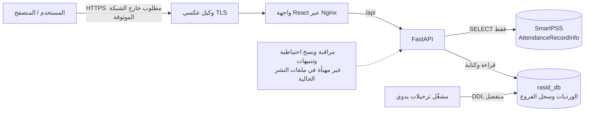
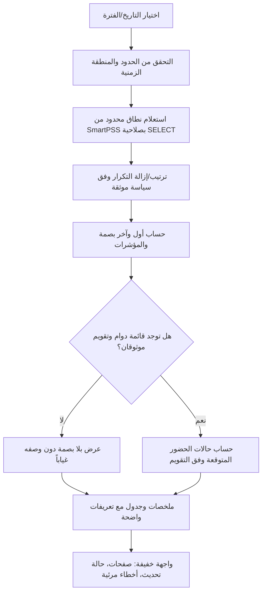
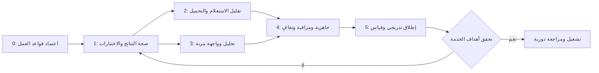

# راصد — تقرير الفحص وخطة التطوير

**التاريخ:** 24 أكتوبر 2026  
**النطاق:** قراءة الشيفرة والإعدادات والاختبارات الحالية، وإعداد خطة تنفيذ مقترحة.  
**حالة الوثيقة:** أُعدت هذه الوثيقة كتحليل وخطة فقط. في تحديث لاحق ضُبط عنوان MySQL إلى `192.168.8.3` واستُبدل مفتاح API بتسجيل دخول مشرف ورمز Bearer قصير العمر؛ لم تُعدّل الوثيقة الأصلية بأثر رجعي، لذا تُقرأ الملاحظات المتأثرة كسجل وقت الفحص.

> لا يمكن ضمان تشغيل «24/7» بالشيفرة وحدها. يمكن تجهيز التطبيق للتعافي من الأعطال ومراقبتها، لكن التوافر الفعلي يعتمد أيضاً على الخادم والشبكة وقواعد البيانات والنسخ الاحتياطية والتنبيه والاستجابة للأعطال.

## 1. ملخص تنفيذي

المشروع صغير نسبياً ومكوّن من واجهة React وخدمة FastAPI وقاعدتي MySQL. يقرأ سجلات SmartPSS بصلاحية قراءة، ويكتب بيانات الورديات وسجل الفروع في قاعدة راصد. هذه بنية مناسبة للانطلاق ولا تحتاج إلى إعادة كتابة أو إضافة خدمات وسيطة.

أفضل ترتيب للعمل:

1. حسم قواعد التأخير وتاريخ سريان الوردية وإسناد الفروع.
2. إصلاح الفروقات المؤكدة وتغطيتها باختبارات.
3. تخفيف الاستعلامات والتحميل غير المحدود مع إبقاء قاعدة SmartPSS للقراءة فقط.
4. جعل التحليل مفيداً ومفهوماً من دون مكتبات رسوم أو نماذج بيانات غير لازمة.
5. إضافة فحوص الجاهزية ومراقبة التشغيل وإجراءات التعافي قبل وصف الخدمة بأنها مهيأة للتشغيل المستمر.

### لقطة الوضع الحالي

| المجال | الموجود | الخلاصة |
|---|---|---|
| الواجهة والخلفية | React/Vite وFastAPI؛ واجهة عربية وإدارة ورديات وفروع وتقارير | أساس قابل للتطوير، لكن تحديث البيانات يدوي حالياً |
| البيانات | قاعدة SmartPSS للقراءة وقاعدة راصد للكتابة | فصل الصلاحيات جيد؛ لا تُعدّل مخطط SmartPSS |
| التحليل | عدد حركات، أول بصمة، التأخير، تقرير تجميعي محدود إلى 31 يوماً | يلزم توضيح معاني المؤشرات وحفظ تاريخ الوردية |
| الأداء | تقرير يقرأ كل يوم باستعلام منفصل، ثم يحمل الصفوف ويعالجها في الذاكرة | مسار تحسين واضح قبل إضافة تخزين مؤقت أو خدمات جديدة |
| التعافي | `restart: always`، و`pool_pre_ping` | مفيدان، لكنهما لا يكفيان لفحص الجاهزية أو التنبيه أو ضمان التوافر |
| الاختبارات | اختبارات خلفية، وبناء واجهة، واختبارات متصفح | تحقق محلي سابق: 52 اختبار خلفية نجح والبناء نجح؛ اختبار المتصفح اصطدم بخادم محلي آخر على المنفذ نفسه، لذا يلزم تشغيله في بيئة معزولة |

## 2. صورة البنية الحالية

هذه الوثيقة سجل تاريخي للفحص والخطة السابقة، وليست وصفاً للبنية الحالية. التخزين الحالي لراصد SQLite محلية، وقاعدة SmartPSS الخارجية للقراءة فقط؛ راجع [دليل التشغيل الحالي](./OPERATIONS.md). ملفات Docker وNginx ما زالت موثقة في روابط المشروع أعلاه.

## 3. نتائج فحص العيوب والمخاطر

التصنيف هنا يميز بين **عيب مثبت من الشيفرة** و**فجوة جاهزية أو خطر يحتاج اختباراً**. مستوى الأولوية يعبّر عن ترتيب الإصلاح المقترح، لا عن تعرض النظام لحادث قائم.

| المعرّف | الأولوية | الحالة | الملاحظة والأثر |
|---|---:|---|---|
| D-01 | P1 | فرق مثبت بين التوثيق والسلوك | دالة `late_minutes` تخصم فترة السماح من عدد دقائق التأخير؛ فمثلاً بصمة 08:20 مع بداية 08:00 وسماح 15 دقيقة تُحسب 5 دقائق. لكن README يصف دقائق التأخير بأنها الفرق عن بداية الوردية، أي 20 دقيقة. يلزم اعتماد تعريف واحد قبل تغيير الناتج أو التقارير. |
| D-02 | P1 | قيد مثبت في التقارير | تقرير الأيام الماضية يستخدم الوردية النشطة الآن للفترة كلها. تعديل الوردية يغيّر تفسير الماضي، فتكون النتائج التاريخية قابلة للتبدل. لا يوجد سجل لتاريخ سريان الوردية. |
| D-03 | P1 | سلوك عرض مضلل مثبت للتعيين المستقبلي | عند نقل موظف بتاريخ مستقبلي، يُسجّل الفرع الجديد بلا `end_date` فوراً، والواجهة تعرض كل سجل بلا نهاية بأنه «حتى الآن (نشط)». هذا يجعل الإسناد المستقبلي يبدو سارياً حالياً. يلزم حسم دعم النقل المستقبلي، ثم عرض الحالة بحسب تاريخ اليوم لا بحسب خلوّ `end_date` فقط. |
| D-04 | P1 | فجوة جاهزية 24/7 | مسار `/` يعرض وقتاً وحالة عامة لكنه لا يثبت اتصال قاعدتي البيانات. إعداد Compose لا يعرّف `healthcheck` أو تدوير سجلات أو فحص جاهزية لاعتماد الخدمة عليه. `restart: always` يعيد تشغيل الحاوية، لكنه لا يراقب سلامة البيانات أو يرسل تنبيهاً ولا يعالج تعطل المضيف أو قاعدة البيانات. |
| D-05 | P1 | خطر تحميل متكرر على المصدر | تقرير التأخير ينفذ استعلاماً لكل يوم في الفترة (حتى 31 استعلاماً)، ويحمّل سجلات اليوم كاملة ثم يرتبها ويحسبها في التطبيق. تكرار ذلك مع مستخدمين متعددين أو تحديث متكرر قد يرفع الحمل على SmartPSS. |
| D-06 | P2 | أحجام استجابات غير محددة | سجل الحضور اليومي يعيد جميع الحركات بعد التصفية من دون ترقيم صفحات. سجل الفروع له صفحات في API، لكن الواجهة تطلب أول 200 سجل فقط. يلزم قياس الحجم ثم إضافة حدود وعرض صفحات حيث تفيد. |
| D-07 | P2 | تجربة خطأ غير متسقة | فشل الاتصال أثناء نقل الفرع يذهب إلى `console.error` فقط، بينما استجابة الخادم بالفشل تستخدم تنبيهاً. قد لا يعرف المستخدم أن الحفظ لم يصل إلى الخادم، وقد تبقى بيانات قديمة ظاهرة من دون توضيح حداثتها. |
| D-08 | P2 | تنافس التعديلات يحتاج اختباراً | منطق تفعيل وردية واحدة ونقل الموظف يعتمد على قفل الصفوف الحالية. عند غياب صفوف سابقة أو عند طلبين متزامنين، لا يكفي فحص SQLite العادي لإثبات سلامة السلوك في MySQL. لا توجد اختبارات تزامن أو تكامل MySQL مذكورة في مجموعة الاختبارات الحالية. |
| D-09 | P2 | ملاحظة تاريخية عولج جزء منها | عند الفحص كان مفتاح API يمر من المتصفح ويُحفظ في `sessionStorage`. استُبدل لاحقاً بتسجيل دخول مشرف ورمز Bearer في ذاكرة الصفحة لمدة 8 ساعات. ما زال TLS وتقييد الشبكة وإدارة بيانات الدخول مطلوباً؛ الرمز stateless ولا يُبطل فردياً قبل انتهاء صلاحيته. |
| D-10 | P3 | قيود تحليلية ينبغي عدم تجاوزها | يوجد مفهوم وردية نشطة مشتركة، ولا يثبت الكود وجود قائمة دوام موثوقة أو تقويم إجازات أو سياسة دخول/خروج مؤكدة من `AttendanceState`. لذلك لا يجوز عرض «غائب»، أو ساعات عمل، أو مقارنة عدالة بين الموظفين على أنها حقائق قبل توفير تلك المدخلات. |
| D-11 | P3 | تصادم بيئة اختبارات المتصفح محلياً | إعداد Playwright يسمح بإعادة استخدام خادم قائم خارج CI. في الفحص المحلي استُخدم خادم على المنفذ 3005 يعرض واجهة مختلفة ويطلب `/api/employees`؛ هذه ليست دلالة كافية على عيب في نسخة المصدر، لكنها تجعل نتيجة الاختبار المحلي غير موثوقة ما لم يُشغّل خادم الاختبار معزولاً. |

### مواضع الأدلة

- منطق حساب التأخير: [timeutils.py](../backend/timeutils.py)، وتفسير README: [README.md](../README.md).
- معالجة البصمات والتقرير: [attendance_core.py](../backend/attendance_core.py) و[main.py](../backend/main.py).
- إسناد الفروع وعرض السجل: [main.py](../backend/main.py) و[App.jsx](../frontend/src/App.jsx).
- الفحوص والنشر: [database.py](../backend/database.py)، و[docker-compose.yml](./docker-compose.yml)، و[playwright.config.js](../frontend/playwright.config.js).

## 4. ما المقصود بتحليل مفيد؟

يجب أن يفصل العرض بين **الحركة** و**الموظف**. عدد البصمات ليس عدد الحاضرين. المؤشرات المقترحة للمرحلة الأولى:

| المؤشر | التعريف المقترح | الشرط/التحفظ |
|---|---|---|
| الموظفون الذين سجلوا بصمة | عدد أرقام الموظفين الفريدة في الفترة/اليوم | يستثنى المعرّف المفقود أو يعرض كمجموعة غير معرّفة منفصلة |
| عدد الحركات | عدد الحركات بعد قاعدة إزالة التكرار الحالية | تسمية واضحة؛ لا تساوي عدد الموظفين |
| المتأخرون | عدد الموظفين الذين تجاوزت أول بصمة لهم عتبة التأخر المعتمدة | يعتمد على سياسة السماح وبداية الوردية |
| دقائق التأخر | إجمالي الدقائق وفق تعريف معتمد | يوضح هل يبدأ العد بعد السماح أم من وقت بداية الوردية |
| اتجاه التأخير | مجموع/عدد المتأخرين حسب اليوم في فترة مختارة | مقارنة الفترات لا تصحح أثر تغيّر الوردية تلقائياً |
| بلا بصمة | موظف معروف لا توجد له بصمة في التاريخ المحدد | لا يُسمى «غائباً» دون قائمة موظفين متوقعين وتقويم دوام موثوق |
| أول/آخر بصمة | أول وآخر حركة مسجلة للموظف في اليوم | لا تُسمى دخولاً/انصرافاً قبل التحقق من معنى الحالة في SmartPSS |

**النسخة الخفيفة المقترحة:** بطاقات ملخص قليلة، جدول قابل للبحث والفرز، وشريط اتجاه يومي بسيط بـ SVG/CSS أو HTML. لا تُضاف مكتبة رسوم قبل إثبات الحاجة. لا يُضاف مخزن بيانات أو cache دائم لمجرد عرض الرسوم.

## 5. خطة التطوير المرحلية

كل مرحلة لها مخرج قابل للمراجعة وبوابة انتقال. لا تبدأ المرحلة التالية قبل اجتياز اختبارات المرحلة الحالية.

### المرحلة 0 — تثبيت قواعد البيانات والسياسة

**العمل**

1. اعتماد معنى `late_minutes`: الدقائق بعد السماح أم بعد بداية الوردية.
2. تحديد هل يسمح بإنشاء نقل فرع مستقبلي، وكيف يظهر الفرع الحالي/المستقبلي في الواجهة.
3. تقرير ما إذا كانت الوردية واحدة للجميع كافية، أم أن ربط ورديات مختلفة بالموظفين مطلوب فعلاً. لا يُنشأ نموذج إسناد موظف–وردية إلا عند ثبوت الحاجة.
4. التحقق بعينات من `AttendanceState` و`AttendanceDateTime` وتأكيد المنطقة الزمنية من مصدر موثوق، من دون طباعة بيانات موظفين أو أسرار.
5. توثيق ما هو معروف وما لا يمكن استنتاجه: الغياب، الدخول/الخروج، أيام الدوام، والإجازات.

**المخرج وبوابة الانتقال:** جدول قواعد أعمال معتمد، وأمثلة رقمية على نتائج التأخير والنقل التاريخي.

### المرحلة 1 — تصحيح صحة النتائج وحماية البيانات

**العمل**

1. تعديل منطق التأخير والتوثيق والاختبارات كوحدة متسقة بعد قرار المرحلة 0.
2. حفظ تاريخ سريان الوردية عند تغيرها، أو التصريح بوضوح بأن التقرير التاريخي «معاد الحساب على الوردية الحالية» إلى أن تتوفر بيانات التاريخ.
3. إصلاح تمثيل الإسناد المستقبلي وعرض الحالة الفعلية في جدول الفروع.
4. اختبار قواعد تداخل تاريخ الفروع عند تواريخ البداية والنهاية، والموظف بلا سجلات، والنقل المستقبلي.
5. إضافة اختبارات لتفعيل الورديات والنقل المتزامن باستخدام MySQL في CI أو بيئة تكامل مؤقتة قبل الاعتماد على ضمانات القفل.

**المخرج وبوابة الانتقال:** اختبارات توضح السلوك المعتمد وتمنع رجوع الفروقات الحسابية.

### المرحلة 2 — جعل التقرير خفيفاً وقابلاً للتوسع

**العمل**

1. استبدال استعلام اليوم المتكرر في تقرير التأخير باستعلام نطاق واحد محدد بحدين زمنيين، ثم التجميع اليومي في الذاكرة مع الحفاظ على حدود اليوم والمنطقة الزمنية.
2. قياس `EXPLAIN` ومؤشرات الجدول وفهارسه الحالية. لا تُجرى أي كتابة أو ترحيل على قاعدة SmartPSS؛ أي تحسين في مخطط مصدر البصمة يتطلب موافقة مالكه.
3. وضع حد وحجم صفحة للاستجابة التفصيلية للحركات عند الحاجة؛ إبقاء ملخص الأرقام خفيفاً وإرجاع التفاصيل على صفحات.
4. إبقاء بيانات كل طلب مؤقتة ضمن عمر الطلب، وإغلاق جلسات قواعد البيانات كما هو معمول به. لا تُنشأ قوائم عالمية أو مؤقتات خلفية تجمع السجلات في الذاكرة.
5. قياس زمن استجابة API، وعدد الصفوف، وحجم JSON قبل وبعد التحسين على بيانات ممثلة.

**المخرج وبوابة الانتقال:** حمل قراءة محدد وقابل للقياس من المصدر، مع تطابق نتائج التقرير قبل التحسين وبعده على حالات الاختبار.

### المرحلة 3 — تطوير لوحة التحليل وتجربة الاستخدام

**العمل**

1. ترتيب العرض من الأعلى إلى الأسفل: تاريخ/فلاتر، ملخص الموظفين والحركات والتأخير، اتجاه يومي، ثم جدول التفاصيل.
2. اعتماد تعريفات المرحلة 0 وعرضها قرب المؤشرات؛ استخدام «بلا بصمة» بدلاً من «غائب» عندما لا تتوفر بيانات الدوام المتوقعة.
3. إضافة بحث بالاسم/الرقم، وتصفية بالتاريخ والفرع والوردية فقط إذا كانت علاقة البيانات معرفة فعلاً.
4. إضافة عرض أسبوع/شهر/فترة مخصصة بحدود صريحة، مع مقارنة بالفترة السابقة فقط عندما يكون تفسير تغير الوردية معلوماً.
5. جعل الواجهة مرنة للجوال وسطح المكتب عبر CSS منظم ونقاط توقف واستخدام جداول قابلة للتمرير أو عرض صفوف مبسط على الشاشات الصغيرة.
6. إظهار حالة التحميل والخطأ وآخر تحديث بوضوح؛ استبدال الأخطاء الصامتة أو رسائل `alert` بتغذية راجعة مرئية ومتسقة.
7. استخدام رسوم SVG/CSS خفيفة، وعدم إدخال مكتبة مخططات أو نظام إدارة حالة ما دام React state الحالي كافياً.

**المخرج وبوابة الانتقال:** سيناريوهات مستخدم مكتملة على الهاتف والكمبيوتر، مع اختبارات متصفح مستقرة.

### المرحلة 4 — تجهيز التشغيل المستمر والتعافي

**العمل**

1. تقسيم فحص الصحة إلى:
   - `live`: هل عملية التطبيق تعمل؟
   - `ready`: هل يمكن للخدمة تلبية الطلبات، وهل قواعد البيانات المطلوبة متاحة ضمن مهلة محددة؟
   - عدم كشف كلمات السر أو بيانات الاتصال في نتائج الفحص.
2. إضافة `healthcheck` للخدمات المناسبة في Compose، وربط انتظار الواجهة بجاهزية الخلفية حيث يمكن ذلك. توثيق أن قاعدة MySQL الخارجية تحتاج مراقبة منفصلة.
3. ضبط مهلات اتصال وقراءة قواعد البيانات وحجم الاتصال وإعادة تدوير الاتصالات؛ حساب سقف الاتصالات على أساس عدد عمال التطبيق ومجموعتي المحركات، لا اختيار أرقام كبيرة عشوائياً.
4. ضمان أن التحديث الدوري في الواجهة لا يعمل إلا عندما تكون الصفحة مرئية، ولا يبدأ طلباً جديداً قبل انتهاء السابق. استخدام مهلة/إلغاء للطلب القديم وإظهار البيانات القديمة مع تحذير حداثة بدلاً من تراكم الطلبات.
5. إبقاء إعادة المحاولة محدودة لطلبات القراءة فقط وبفواصل متدرجة مع عشوائية بسيطة. لا تُكرر عمليات الكتابة تلقائياً ما لم يوجد مفتاح منع تكرار مناسب.
6. تحديد سياسة سجلات محدودة الحجم والاحتفاظ، مع منع تسجيل مفاتيح API أو كلمات المرور أو بيانات حضور حساسة.
7. مراقبة توافر الموقع وأخطاء API واتصال كل قاعدة وزمن الاستجابة واستهلاك القرص/الذاكرة/الاتصالات؛ توجيه تنبيه عند تجاوز عتبات متفق عليها.
8. توثيق نسخ قاعدة راصد، ونسخ SmartPSS لدى مالكها، وخطوات الاستعادة واختبار استعادة دوري. إعادة تشغيل الحاوية ليست نسخة احتياطية.
9. استخدام TLS، وتقييد الوصول الشبكي، والتحقق من إعدادات proxy ومحدد المعدل قبل إتاحة الخدمة خارج الشبكة المحلية.
10. كتابة إجراء تشغيل: نشر إصدار، ترحيل قاعدة راصد يدوياً بحساب الترحيل المنفصل، فحص الجاهزية، الرجوع إلى الإصدار السابق عند فشل الإصدار، والتصعيد عند تعطل قاعدة خارجية.

**المخرج وبوابة الانتقال:** تشغيل تجريبي مع فشل/عودة اتصال قاعدة البيانات، وإعادة تشغيل الحاويات، والتحقق من التنبيه والنسخ والاستعادة.

### المرحلة 5 — إطلاق تدريجي والتحقق

1. تطبيق الخطة أولاً على بيئة اختبار ببيانات منزوعة الهوية أو عينة مصرح بها.
2. أخذ نسخة احتياطية والتحقق من استعادتها قبل أي ترحيل إنتاجي.
3. نشر نسخة محدودة، ومقارنة أرقامها بعينة يدوية معتمدة.
4. مراقبة زمن الاستجابة والأخطاء والاتصالات والحمل على SmartPSS.
5. الإطلاق الكامل فقط بعد نجاح بوابات القبول أدناه؛ الإبقاء على إجراء رجوع واضح.

## 6. مخطط تدفق البيانات والتحليل المستهدف

## 7. خريطة المسار والاعتماديات

## 8. متطلبات التشغيل 24/7 — من دون تعقيد مبكر

### الاسترداد

- إعادة تشغيل الحاويات الحالية خطوة أولى وليست استراتيجية توافر عالية.
- عند سقوط قاعدة البيانات، يجب أن تفشل الطلبات بوضوح وبزمن محدود، وتستعيد الخدمة نفسها بعد عودة القاعدة من دون إعادة تشغيل يدوية متكررة.
- عدم تخزين بصمات متراكمة في RAM أو بناء عامل خلفي دائم ما دام النظام يقرأ المصدر مباشرة عند الطلب.
- إذا كان المطلوب تحمل تعطل الخادم نفسه، فذلك يحتاج بنية متعددة العقد/قاعدة عالية التوافر وموازنة حمل وميزانية تشغيل؛ خارج نطاق «تحسين بسيط» ويحتاج قراراً منفصلاً.

### تحديث المتصفح

- تحديث دوري افتراضي مقترح كل 30 ثانية، قابل للضبط لاحقاً، مع إيقافه عند إخفاء التبويب.
- منع الطلبات المتداخلة، وإلغاء الطلب عند تغيير التاريخ أو مغادرة الصفحة، وعرض «آخر تحديث ناجح».
- إعادة الاتصال بعد انقطاع مؤقت تكون محدودة وبفواصل متدرجة؛ عدم تكرار الطلبات على نحو يضاعف الحمل.

### مراقبة ونسخ

- فحص جاهزية من مراقب خارجي، وتنبيه عند استمرار الفشل لا عند خطأ عابر منفرد.
- تدوير سجلات الحاويات وحد احتفاظ واضحان، مع مراقبة مساحة القرص.
- نسخ احتياطي مجدول لقاعدة راصد واختبار استعادة؛ تنسيق النسخ الخاصة بـ SmartPSS مع مسؤولها وعدم افتراض ملكية التطبيق لها.
- تحديد مالك للتنبيه والاستجابة؛ لا تكفي لوحة مراقبة لا يراجعها أحد.

### أهداف أولية للمراجعة

الأرقام التالية **اقتراح لتحديد خط أساس** وليست ضماناً قبل القياس:

| المقياس | هدف مبدئي | طريقة التحقق |
|---|---|---|
| إتاحة واجهة القراءة | هدف شهري يقرره مالك الخدمة (مثلاً 99.5% كبداية داخلية) | مراقبة خارج الحاوية وتسجيل الانقطاعات |
| صحة بيانات الحضور | صفر اختلافات غير مفسرة في العينة المرجعية | مقارنة يومية/أسبوعية مع مصدر معتمد |
| حمل التقرير | استعلام واحد محدود بالفترة بدلاً من استعلام لكل يوم | اختبار يحصي عدد الاستعلامات وزمنها |
| تحديث اللوحة | لا توجد طلبات متداخلة أو تحديث مستمر عند إخفاء الصفحة | اختبار متصفح بمؤقت وفشل/عودة الشبكة |
| التعافي | استعادة الخدمة بعد عودة DB ضمن مهلة تشغيل متفق عليها | اختبار قطع/إعادة اتصال في بيئة اختبار |
| النسخ | استعادة ناجحة موثقة ضمن RPO/RTO يتفق عليهما | تمرين استعادة دوري |

يُراجع هدف الإتاحة على ضوء قاعدة البيانات المستضافة خارج Compose؛ إذا كانت قاعدة واحدة على جهاز واحد، فهي نقطة فشل منفردة مهما كانت سياسة إعادة تشغيل الحاوية.

## 9. معايير قبول قبل اعتبار الخطة منجزة

- تعريف التأخير واحد في الكود والواجهة والتوثيق والاختبارات.
- تقرير تاريخي لا يبدل معنى الأيام بصمت بعد تعديل وردية؛ أو يعلن بوضوح قيد إعادة الحساب الحالي.
- لا يظهر إسناد فرع مستقبلي على أنه الفرع الحالي قبل تاريخ سريانه.
- جميع الحسابات التحليلية تفرق بين الموظفين الفريدين والحركات.
- لا تعرض المنصة الغياب أو الدخول/الخروج دون مصدر بيانات موثوق يثبت ذلك.
- كل تقرير مقيد بفترة وصفحات أو حدود معلومة، ولا يكرر استعلاماً لكل يوم بلا داع.
- واجهة جوال واضحة، وحالات تحميل/خطأ/حداثة ظاهرة.
- تتعافى الخدمة من انقطاع DB وتكشف عدم الجاهزية للمراقب من دون كشف أسرار.
- توجد سجلات محدودة الاحتفاظ، وتنبيه مجرّب، ونسخة احتياطية استعيدت فعلياً.
- تنجح اختبارات الخلفية وبناء الواجهة واختبارات المتصفح على خادم الاختبار الخاص بها، لا على خادم محلي غير معروف.

## 10. أسلوب التنفيذ المقترح

- تغييرات صغيرة ومترابطة في كل مرحلة؛ لا إعادة كتابة للتطبيق.
- لا Redis ولا Celery ولا خدمة تحليلات منفصلة ولا cache دائم في النسخة الأولى.
- لا تعديلات على قاعدة SmartPSS ولا ترحيل عليها.
- اختبارات قبل الترحيل، وخطة رجوع، وقياس قبل/بعد لكل تحسين أداء.
- تحديث [README.md](../README.md) عند تغيير قواعد العمل أو التشغيل أو إعدادات 24/7، مع إبقاء هذه الوثيقة خارطة طريق لا بديلاً عن دليل التشغيل.

## 11. ميميات مهنية — تذكير بروح هندسية هادئة

> **المدير:** «أريد 24/7».  
> **المهندس:** «ممتاز. من يراقب قاعدة البيانات، ومن يستلم التنبيه الساعة 03:00؟»  
> **الدرس:** `restart: always` سياسة إعادة تشغيل، وليست مناوبة تشغيل.

> **لوحة التحليل قبل تعريف المؤشر:** «لدينا 300 بصمة، إذن حضر 300 موظف!»  
> **بعد التعريف:** «لدينا 300 حركة و184 موظفاً فريداً؛ والباقي تكرارات/حركات إضافية».  
> **الدرس:** الحركة حدث، والموظف كيان؛ لا تجعل الرسم البياني يخلط بينهما.

> **اختبار الواجهة:** «نجحت على جهازي».  
> **Playwright:** «لقد اتصلت بخادم شخص آخر على المنفذ نفسه».  
> **الدرس:** اعزل خادم الاختبار قبل لوم التطبيق.
